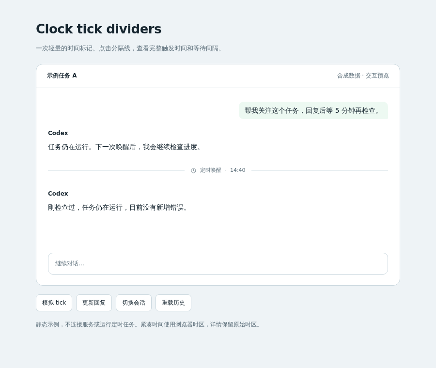

# Clock tick dividers

## Behavior

A complete `<clock_tick>` prompt with a positive numeric `period_m` and a
timezone-aware ISO `current_time` becomes a thin divider with a small clock,
“定时唤醒” and the trigger time. Click or keyboard-activate it to see the full
timestamp and delay after the previous reply. The compact time uses the browser's
timezone; details retain the recorded timestamp and UTC offset.

Ordinary prompts, quoted examples, malformed notifications and other background
events keep their original rendering. Replies, errors and tool records stay
visible. Existing historical ticks and incoming ticks use the same presentation.
This is presentation only; it does not change timers, prompts or saved history.

## Source

- [source/custom.js](source/custom.js): parses complete clock prompts and attaches
  a native expandable divider alongside the original prompt element.
- [source/custom.css](source/custom.css): divider, focus and mobile styles using
  the page's existing theme variables.
- [source/fixture.mjs](source/fixture.mjs): synthetic conversation and controls
  for incoming ticks, reply updates, session changes and history reloads.
- [source/verify.mjs](source/verify.mjs): repeatable browser lifecycle checks.
- [preview.html](preview.html): interactive example using the supplied source.

## Integration

Copy this directory into `~/.pycodex/frontend/optional_features/clock-ticks/`.
Append this side-effect import to the existing `~/.pycodex/frontend/custom.js`,
preserving its existing imports and exports:

```js
import "./optional_features/clock-ticks/source/custom.js";
```

Append this import to `~/.pycodex/frontend/custom.css` (before any ordinary rules):

```css
@import "./optional_features/clock-ticks/source/custom.css";
```

Refresh the workspace. No build step, external dependency or server restart is
needed. The module observes `#log` and direct `.entry.user > .text` prompt
elements. It preserves their class names, source text and renderer-owned nodes.
It adds a `data-clock-tick` attribute and its own `<details>` sibling; CSS hides
the source only on successfully parsed notifications.

The script initializes after DOM readiness, decorates already-loaded history,
and watches prompt additions/changes. Repeated mounting is idempotent;
`installClockTicks(log)` returns a cleanup function that disconnects observation,
removes the presentation and reveals the untouched source. Session changes
remove entries through the host's normal renderer.

Remove the two imports and refresh to undo. `?builtin=1` also bypasses all user
customizations.

To run the standalone example, from the repository root:

```bash
python3 -m http.server 8765 --bind 127.0.0.1 --directory packages/pycodex-ws/workspace_server/optional_features/clock-ticks
```

Open `http://127.0.0.1:8765/preview.html` to try the controls. Add `?verify` to
run the browser checks and display their PASS/FAIL result. Stop the server with
Ctrl-C. The example contains only synthetic data and makes no API requests.

## Validation

The preview's `?verify` mode covers existing history, newly arriving ticks,
source-node preservation, stable open details during reply updates, repeated
mounting, ordinary/malformed/quoted prompts, payload escaping, source replacement,
character-data updates, session/history replacement, cleanup and remounting.

Additional Chromium checks cover keyboard activation, actual refresh, desktop
and 390px layouts, and the current built-in conversation renderer. The source
has also been checked against 64 historical notifications in a running local
workspace, including refresh, session switching and built-in recovery. Those
conversation records are not part of this example.

Validation does not start a real clock or model run. The display consumes
existing prompt DOM, so new arrivals and reply streaming are exercised with
synthetic updates.

## Preview

[Interactive preview](preview.html).



[Mobile screenshot](preview-mobile.png).

The closed divider occupies one quiet row. Opening it reveals two detail rows.

## Limitations

Labels currently use Chinese. This source assumes the documented conversation
DOM and requires adaptation if a full custom template replaces it. A user prompt
that exactly reproduces a valid clock envelope is visually indistinguishable
from a generated tick in that DOM. This implementation does not add timer
controls, countdowns, animation or grouping of repeated checks.
