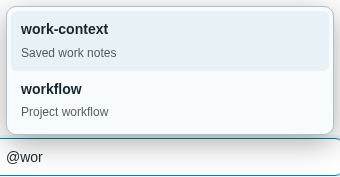

# Skill completion

## Behavior

Type `@` or `$` followed by a skill-name prefix. Up/Down selects, Tab/Enter or
click inserts `$skill-name `, Escape dismisses, and a second Enter submits.
The default page stays unchanged until this feature is applied.

## Source

[Controller](source/skill-completion.mjs), [styles](source/skill-completion.css),
[mount adapter](source/custom.js), [CSS adapter](source/custom.css), and
[prefix checks](source/verify.mjs).

## Integration

Through Customize, ask to apply `skill-completion`. Copy the controller next to
the user's `custom.js`, merge `mountSkillCompletion(host)` into the existing
`mount(host)`, and import the stylesheet. Preserve unrelated customizations.

The adapter uses existing draft/session host methods and reads `GET api/skills`
as `{skills: [{name, description}]}`. All filtering and insertion run locally.
The generic `replaceDraftText` host method preserves editor undo and context
chips. No external runtime libraries are required.

Optional `loadItems(signal)`, `query(parts, selection)` and `insertText(item)`
callbacks can adapt the dropdown to other catalogs. Unmount cleanup cancels
requests, removes listeners/menu, and restores the input attributes.

## Validation

Node: `node packages/pycodex-ws/workspace_server/optional_features/skill-completion/source/verify.mjs`.
Chromium checks covered default-off, keyboard/click/touch, undo/chips, Unicode,
IME, stale responses, error handling, custom catalogs and cleanup.
The full browser harness is a local verification artifact, not shipped code.

## Preview

## Limitations

Requires explicit customization. Catalogs reload on session switch or page
refresh. File/command catalog acquisition requires customization callbacks.
Validation used Chromium and synthetic services, not physical phones or live models.
