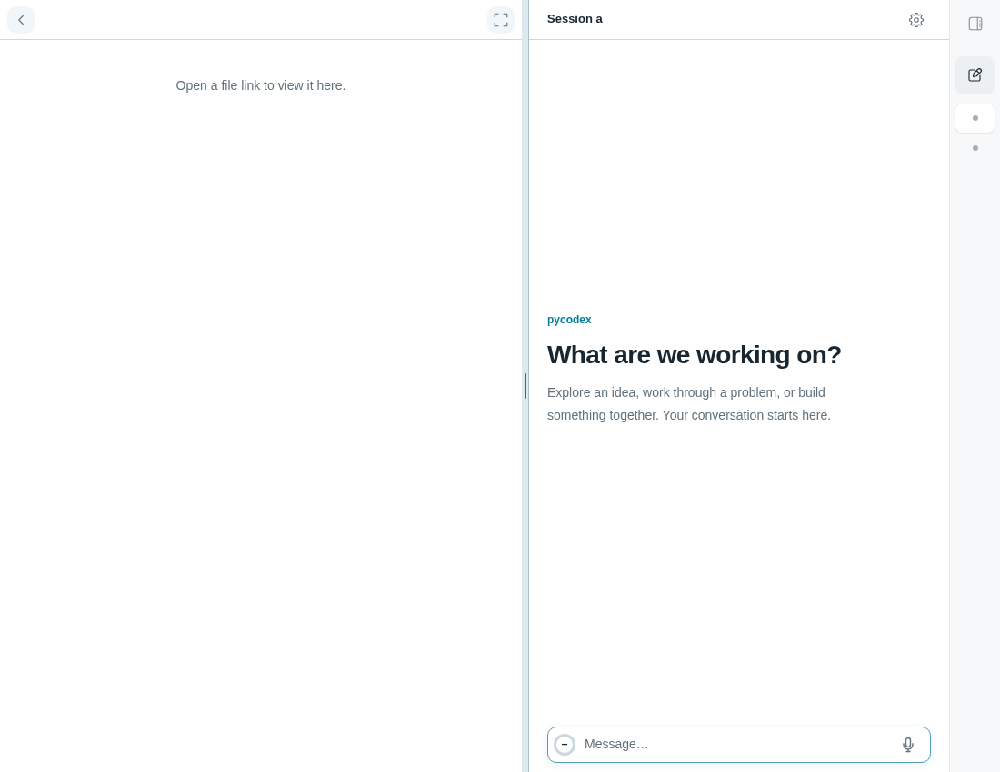

# Step Plan voice input

## Behavior

A single microphone button sits beside the composer. Click to record and click
again to finish, up to 60 seconds. The first click asks for a Step API key if
none is saved; saving it starts recording. Recording shows a stop icon, and
recognition/text cleanup shows a spinner. Click the spinner or press Escape
to cancel. There is no permanent status bar or separate settings button.

For example, dictate a request while keeping an existing file-context token in
the draft. The browser records the audio, transcribes it with
`stepaudio-2.5-asr`, and asks `step-3.7-flash` to tidy punctuation, repetition
and supported recognition corrections while preserving the original meaning.
Only the finished text is inserted at the remembered cursor. It remains
editable and undoable; it is never submitted as a message automatically.

The button does not increase the empty composer's height. Insertion does not
focus an unfocused editor, helping avoid opening the mobile keyboard. Session
changes, message submission and page hide cancel current work; late responses
cannot write into another draft. Failed or incomplete cleanup leaves the draft
unchanged. Errors use a temporary notice; rejected keys reopen the key dialog.

## Source

- [voice-input.js](source/voice-input.js): audio conversion, Step Plan requests,
  SSE parsing, text cleanup, recording controls, draft editing and cleanup.
- [voice-input.css](source/voice-input.css): compact button, progress icon,
  key dialog and mobile styles.
- [custom.js](source/custom.js): minimal built-in `mount(host)` adapter.
- [custom.css](source/custom.css): stylesheet import example.
- [verify.cjs](source/verify.cjs): browser verification using the repository's
  real workspace page/composer, a simulated microphone and mocked model APIs.

## Integration

Read the installed `WORKSPACE_API.md` and inspect the user's custom frontend.
The source targets the built-in workspace DOM and extension host from 0.6.1.

1. Copy `source/voice-input.js` and `source/voice-input.css` alongside the user's
   `~/.pycodex/frontend/custom.js`.
2. Import `mountVoiceInput` and call it once from the existing `mount(host)`.
   Combine its returned cleanup with existing cleanup; preserve other features.
   [source/custom.js](source/custom.js) is a complete example for an otherwise
   empty customization.
3. Add `@import url("./voice-input.css");` at the start of `custom.css`, before
   ordinary CSS rules. Preserve the user's existing styles.
4. Refresh an HTTPS or localhost workspace page, click the microphone, enter
   a Step API key with Step Plan access, and record a short request.

The host must provide `getActiveSessionId()`, `onSessionChanged(handler)` and
`getDraft()`. The page must retain `#composer`, its `.composer-box`, the
contenteditable `#prompt`, theme variables and `.toast` styling. Text insertion
uses DOM ranges and dispatches an `input` event so the existing Composer records
undo and preserves context tokens. Empty drafts use the Composer's
`br[data-tail]` placeholder. Adapt these assumptions for a full custom template;
`setDraft()` alone resets the built-in undo history.

No backend route, model tool, package dependency or build step is needed.
MediaRecorder output is decoded in the browser and converted to 16 kHz,
mono PCM16. The key and requests stay in the browser-to-Step-Plan path:

- `POST https://api.stepfun.com/step_plan/v1/audio/asr/sse`
- `POST https://api.stepfun.com/step_plan/v1/chat/completions`

The second request contains a cleanup instruction and the final transcription;
it does not include the existing draft or conversation history. Model calls
have a shared 60-second timeout. See the official
[Step Plan audio](https://platform.stepfun.com/docs/zh/step-plan/integrations/audio-api)
and [text-model](https://platform.stepfun.com/docs/zh/step-plan/integrations/reasoning-api)
documentation for service requirements.

Remove the import, mount call and stylesheet import, then refresh to undo.
The returned cleanup removes the feature's elements/listeners and stops its
timers, microphone tracks and pending requests. It leaves the saved key intact.
Clear this site's `pycodex.voice.stepApiKey` localStorage entry or site data to
remove the saved key. `?builtin=1` bypasses user customizations.

## Validation

Run from a repository checkout with Node 18+:

```bash
npm install --prefix /tmp/pycodex-voice-check playwright
node /tmp/pycodex-voice-check/node_modules/playwright/cli.js install chromium
NODE_PATH=/tmp/pycodex-voice-check/node_modules node packages/pycodex-ws/workspace_server/optional_features/voice-input/source/verify.cjs
```

If Chromium is already installed elsewhere, set
`PLAYWRIGHT_CHROMIUM_EXECUTABLE_PATH` to its executable instead of downloading
another browser. Playwright is only a verification dependency.

The harness loads this directory's source into the real workspace page with
synthetic sessions. It uses Chromium's simulated microphone through real
MediaRecorder and audio decoding, intercepts every external request, and
checks the PCM payload and ASR-to-cleanup request sequence. It writes the
desktop and mobile screenshots in this feature directory.

Checks cover the single-button/key flow, key persistence across reload,
transcription staying outside the draft until cleanup finishes, context tokens
and single undo, cancellation during permission/recording/recognition/cleanup,
session switching and late responses in both API stages, HTTP/SSE errors,
truncated cleanup, split UTF-8/CRLF SSE, and no automatic workspace submission.
Touch checks cover repeated insertion without focusing the editor, no leading
blank line, and unchanged composer height with/without the button (40 px at
1100 px width, 38 px at 390 px). Page hide, page-cache restoration, unmount
during recording and reload after unmount are also checked.

These Chromium checks pass with mocked ASR and cleanup responses. They make
no billable model calls and do not read a real key or conversation. Physical
mobile keyboards, Safari/Firefox recording, live ASR accuracy and cleanup
quality have not been verified.

The existing frontend customization and workspace packaging tests also pass
(10 tests on Python 3.10). A workspace wheel and source distribution built with
`uv build --package pycodex-ws` both include all eight feature files.

## Preview



[Mobile screenshot](preview-mobile.png), showing two synthetic dictated text
insertions and the single microphone button. No interactive demo is included;
the verification harness exercises the actual workspace integration.

## Limitations

This is optional reference source, not an automatically enabled extension.
It requires a secure context, microphone permission, modern browser audio and
dialog APIs, Step Plan access, and service CORS support for browser requests.
The saved key is plain localStorage data for the current site, accessible to
scripts on that origin; use a trusted frontend. It is not synchronized between
devices. This source provides no separate key-management control; rejected
keys can be replaced in the dialog, or the saved entry can be cleared above.

UI labels and the cleanup prompt are Chinese, and recognition requests specify
`language: "zh"`. Model names and the service address are fixed in the source.
Recognition starts after recording stops; this is not live bidirectional ASR.
Audio and recognized text go to Step Plan, and both model calls consume its
quota. Audio is not persisted. Interrupted or failed processing requires a new
recording, and refresh does not resume a recording or request.

The cleanup model can still alter wording despite the preservation prompt;
review the draft before sending. Speech never creates a recorded audio message
or a separate entry in the conversation history.
