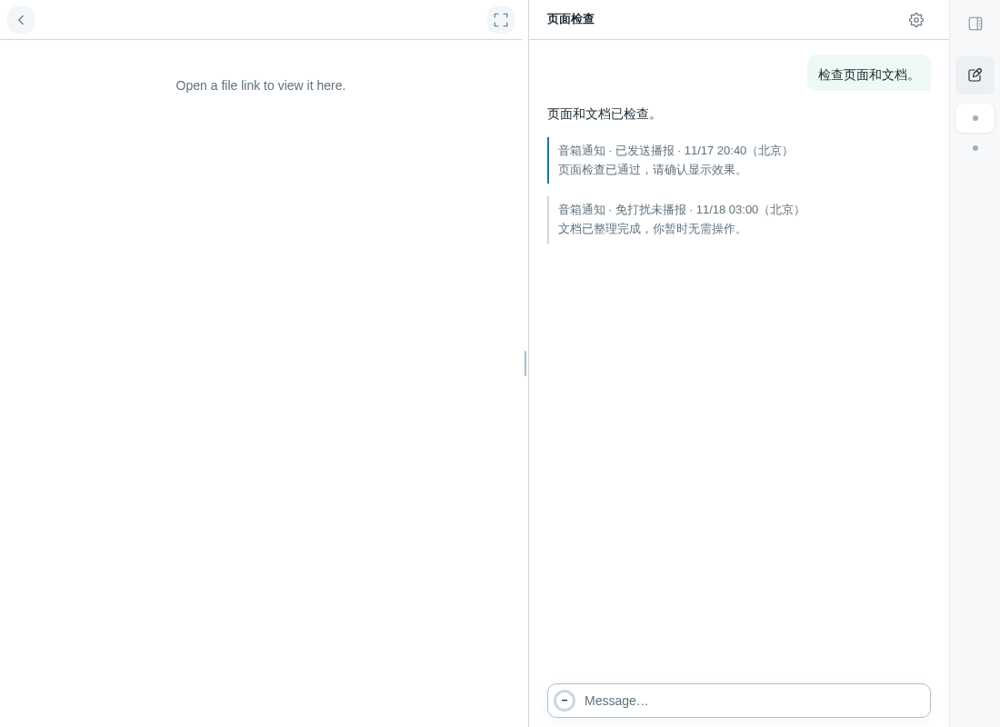

# XiaoAI speaker notifications

## Behavior

After a session finishes its work, generate one fresh Chinese sentence naming
the session, its result and the user's next action. If no action is needed,
say so. Send it to one explicitly selected XiaoAI speaker and show the sentence
and delivery state beside the reply. For example, a completed page check can
produce “页面检查已通过，请确认显示效果。” instead of a fixed completion chime.
An optional `--salutation` adds the user's preferred name.

Intermediate replies do not generate summaries: queued continuations, steer
interruptions, input requests and completions with background work or an enabled
clock are ignored. Completion of a reply alone does not establish task success.
The latest settled result replaces older queued events for that session.
Other sessions retain their own records.

Speech is limited to 50 Unicode characters including punctuation. Beijing time
01:00 inclusive to 10:00 exclusive is quiet time: generate and record the
sentence, but do not speak or replay it later. Recheck the time after generation,
after waiting for another notification, and immediately before the device request.

The SQLite journal preserves sent, quiet, superseded, failed and uncertain
delivery records by rollout path across page refresh and service restart.
Neither records nor history restoration create Agent input. Delivery interrupted
by a process exit is marked uncertain and is never automatically replayed.

## Source

- [notifications.py](source/notifications.py): workspace-owned queue, freshness,
  subprocess execution, quiet hours and private SQLite journal.
- [workspace.patch](source/workspace.patch): explicit reference adaptation of the
  0.6.2 manager lifecycle, session snapshot and conversation renderer.
- [summarize.py](source/summarize.py): one short model request, with one formatting
  correction attempt, using an existing Codex provider configuration.
- [xiaoai.py](source/xiaoai.py): Xiaomi QR login, explicit speaker selection, MiNA
  and MIoT transports, and one service-token renewal on HTTP 401.
- [test_notifications.py](source/test_notifications.py),
  [test_xiaoai.py](source/test_xiaoai.py),
  [runtime_checks.py](source/runtime_checks.py) and [verify.cjs](source/verify.cjs):
  isolated behavior and browser checks.

## Integration

This example includes a **backend adaptation**. It cannot provide reliable
notifications when the browser is closed through a frontend-only import.
Nothing in this directory is registered, imported or enabled by installation.
Apply it explicitly to a source checkout; keep existing customizations and
review conflicts when adapting it to a different version.

From a clean pycodex 0.6.2 checkout:

```sh
feature=packages/pycodex-ws/workspace_server/optional_features/xiaoai-notifications
git apply --check "$feature/source/workspace.patch"
git apply "$feature/source/workspace.patch"
cp "$feature/source/notifications.py" packages/pycodex-ws/workspace_server/notifications.py
env -u VIRTUAL_ENV uv sync --dev
```

The patch adds only lifecycle observation and display state; it does not add
Agent tools or change the Agent execution loop. For a full custom frontend,
adapt its conversation rendering of `snapshot.notifications`. Credentials,
notification configuration and the journal must stay outside served directories.

Use Python 3.8+ for the helper commands. `requests` is their only third-party
dependency besides the installed, matching `python-codex` used by `summarize.py`.
It is already installed in the checkout's uv environment. A separate device
environment can install `requests>=2.27.1` explicitly; neither package gains an
extra or automatic speaker dependency.

```sh
.venv/bin/python "$feature/source/xiaoai.py" login --canvas /path/to/login.html
.venv/bin/python "$feature/source/xiaoai.py" devices
.venv/bin/python "$feature/source/xiaoai.py" select 1
.venv/bin/python "$feature/source/xiaoai.py" test
```

Open the HTML in the workspace Canvas, scan with the account bound to the
speaker, and confirm login on the phone. Select the intended device using its
listed index. Listen to the initial test: server acceptance does not prove
audible playback. No device is selected automatically and volume is unchanged.

Tokens and device selection are saved in `~/.config/pycodex-xiaoai` (directory
0700, files 0600). The leading `--state-dir` option changes that location.
The login page backs up existing HTML beside the file and removes the QR image
after success or failure. Never commit the state directory.

Create `~/.pycodex/notifications.json`, replacing every example path:

```json
{
  "enabled": true,
  "workspace_state_paths": ["/path/to/workspace-state-prefix"],
  "prepare_command": [
    "/path/to/checkout/.venv/bin/python",
    "/path/to/feature/source/summarize.py",
    "--config", "/path/to/codex/config.toml"
  ],
  "deliver_command": [
    "/path/to/checkout/.venv/bin/python",
    "/path/to/feature/source/xiaoai.py", "deliver"
  ]
}
```

Add `--salutation` and the desired name to `prepare_command` if wanted.
An absent configuration, or `enabled: false`, creates no queue or journal and
runs no command. `workspace_state_paths` restricts notifications to selected
workspaces; omitting it enables all workspaces owned by that service.
The command lists are administrator-controlled argv, not shell snippets.

Restart the workspace service after applying the source and configuration.
The manager uses its existing session subscription and drains notification work
when closing; there is no separate notification daemon.
Disable with `enabled: false` and restart. Records remain on disk. To remove the
adaptation, reverse `workspace.patch` and remove the copied module after checking
for later edits. Remove Xiaomi state separately if no longer wanted.

## Validation

From the checkout:

```sh
feature=packages/pycodex-ws/workspace_server/optional_features/xiaoai-notifications
uv run --dev python -m unittest discover -s "$feature/source" -p 'test_*.py' -q
# After applying the backend adaptation:
uv run --dev pytest "$feature/source/runtime_checks.py"
NODE_PATH=/path/to/playwright/node_modules node "$feature/source/verify.cjs"
```

The 44 passing unit checks cover default-off behavior, explicit device selection, private
file permissions, 401 recovery including non-JSON error bodies, no replay of
other failures, final-only generation, structured requests, quiet-time boundaries,
stale results, duplicate events, restart and per-session records. Tests use
temporary credentials and fake model/device responses.

Three passing real Runtime tests check completion, quiet time, restart restoration and
steer during model execution, with no summary generated while work continues.
The browser harness uses the adapted real workspace template and synthetic
sessions. It checks sent/quiet/failure text, idempotent updates, refresh,
session switching, HTML escaping and mobile width. All requests are intercepted.
It writes the previews below. Set `PYCODEX_NOTIFICATION_WORKSPACE` to test another
adapted `workspace_server` directory. Playwright and Chromium are validation-only
dependencies; `PLAYWRIGHT_CHROMIUM_EXECUTABLE_PATH` can select an existing browser.

Historical physical-device validation confirmed MIoT playback on an X08C.
MiNA accepted that device's request without audible speech. The reference-source
tests do not speak, use a live account, or establish support for other hardware.

## Preview



[Mobile screenshot](preview-mobile.png). Both use synthetic sessions and show
the exact speech plus whether it was sent or suppressed during quiet time.

## Limitations

The patch targets 0.6.2 and needs review when the workspace internals change.
This is reference source, not a general plugin system or a browser-only add-on.
The journal is `<state_path>.pycodex-notifications.sqlite3`; speech is private
workspace data and is visible wherever that session is shared.

Xiaomi's cloud endpoints are unofficial and may expire or change. MIoT uses
the China endpoint and supports the verified action layouts for X08C
(service 3/action 1) and X08A (service 5/action 1); X08A playback was not
physically verified. Unknown layouts fail. Transports are never silently
switched or broadcast to other devices. An expired account may require a new QR.

The summary prompt, UI and quiet-time policy are Chinese/Beijing-specific
reference defaults. Adapt them together for another locale. Summary generation
sends the session title and latest request/result to the configured model and
consumes its quota. A model can still summarize incorrectly; no fixed success
message substitutes for generation failure.

Protocol references:
[MiService MiNA API](https://github.com/Yonsm/MiService/blob/master/miservice/minaservice.py)
and [Xiaomi QR login flow](https://github.com/PiotrMachowski/Xiaomi-cloud-tokens-extractor/blob/master/token_extractor.py).
